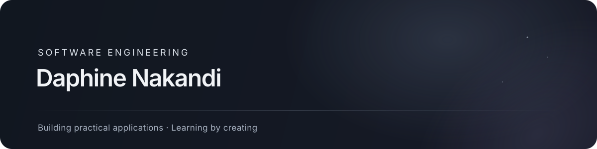

  

  <em>Software engineering · Python · Django · AI-powered applications</em>

---

## A little about me

I'm a software engineering student who enjoys turning ideas into practical applications. I work mainly with Python and Django, and I'm building my understanding of APIs, frontend development, and LLM-powered tools through hands-on projects.

I learn by building, testing, improving, and understanding the decisions behind the code.

## What I'm working with

  
  
  
  
  
  
  
  

*Currently expanding my frontend skills and exploring LLM application development.*

## Selected projects

### [Hardware Stock & Sales Management](https://github.com/DaphineNakandi/Hardware-System-Management)
A Django application for managing a hardware shop's products, stock movements, sales, suppliers, and customer deposit accounts.

**Focus:** Django · Python · SQLite · Django REST Framework

### [Interview Prep Coach](https://github.com/DaphineNakandi/interview-prep-coach)
A Streamlit application that uses language models to generate role-focused interview questions, provide reference answers, and give feedback on practice responses.

**Focus:** Python · Streamlit · LLM APIs · Prompting · Testing

### [AI-Powered Learning Companion](https://github.com/DaphineNakandi/interactive-learning-tool)
A command-line study tool that generates quiz questions, evaluates freeform answers, and tracks practice results.

**Focus:** Python · OOP · OpenAI API · JSON · pytest

### [D&D Combat Game](https://github.com/DaphineNakandi/dnd-combat)
A text-based combat game built while practising object-oriented programming, type hints, input validation, and automated testing.

**Focus:** Python · OOP · pytest

---

## Beyond the code

I enjoy learning how software can solve everyday problems, and I'm especially interested in building useful, accessible digital experiences.

## Find me

- **LinkedIn:** [linkedin.com/in/daphine-nakandi-03b5a6241](https://www.linkedin.com/in/daphine-nakandi-03b5a6241/)
- **GitHub:** [github.com/DaphineNakandi](https://github.com/DaphineNakandi)

---

  Learning continuously. Building thoughtfully.

